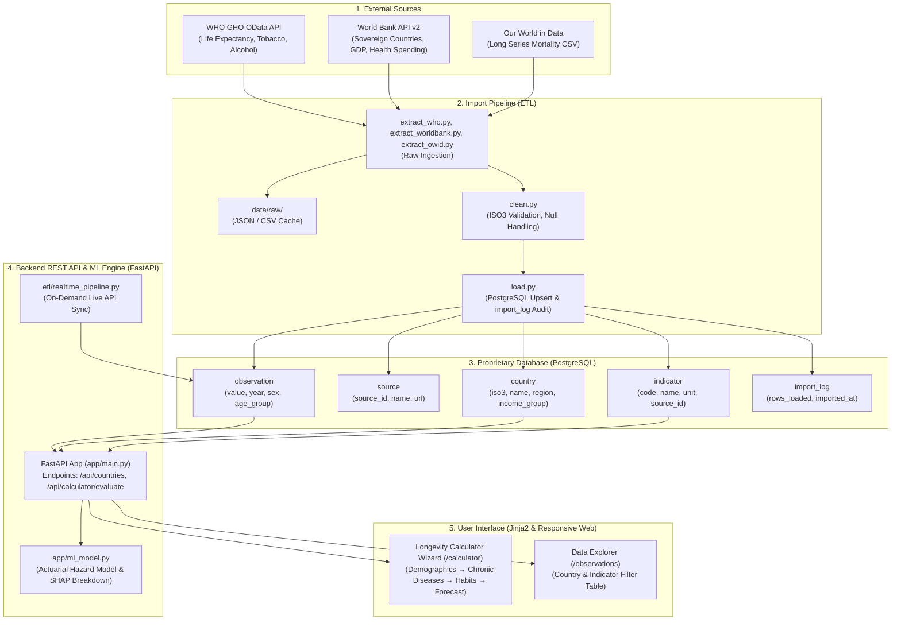

# Lab 1 Report: Global Health Data Platform
**Course:** Global Health Analytics & Big Data Systems  
**Student:** STANICHEVICI R.R. TUDOR  
**Group:** AISRGH  
**Email:** tudor.stanichevici@student.usv.ro  
**Registered Topic:** Life Expectancy, Chronic Diseases, and Behavioral Risk Factors: A Predictive Longevity Platform  
**Environment:** macOS (Darwin arm64 / x86_64) · PostgreSQL 17.5 · Python 3.14 · FastAPI  

---

## 1.10 Deliverables Checklist Verification

| Task | Description | Status | Evidence / Implementation |
| :--- | :--- | :---: | :--- |
| **Task 1.2** | Topic proposal: research question, relevance, target users, ML idea | **☑ Completed** | Section 1 of this report & `README.md` |
| **Task 1.3** | Development environment installed, with tool versions listed | **☑ Completed** | Section 2: Python 3.14.8, Git 2.50.1, PostgreSQL 17.5 |
| **Task 1.4** | PostgreSQL running and connected (pgAdmin / psql) | **☑ Completed** | Section 3: User `gh_user`, DB `global_health` verified |
| **Task 1.5** | Challenges table extended with at least two topic-specific challenges | **☑ Completed** | Section 4: 5 challenges analyzed with solutions |
| **Task 1.6** | Architecture diagram adapted to your project, and folder structure | **☑ Completed** | Section 5: 5-layer decoupled Mermaid diagram & tree |
| **Task 1.7** | List of indicators with codes, sources and units, tested in browser | **☑ Completed** | Section 6: WHO & World Bank endpoints tested & verified |
| **Task 1.8** | Database schema, with justified changes for your topic | **☑ Completed** | Section 7: Extended with `age_group` in `db/schema.sql` |
| **Task 1.9** | Tables created and schema exported | **☑ Completed** | Section 8: 34,129 rows loaded, `schema_dump.sql` exported |

---

## 1. Task 1.2: Project Topic Proposal

### 1.1 Research Question
> **"How do national baseline healthcare indicators, chronic disease burdens, and individual behavioral risk factors (tobacco, alcohol, exercise, BMI) interact to determine human life expectancy, and how accurately can personalized longevity be predicted relative to sovereign baselines?"**

### 1.2 Relevance to SDG 3
Life expectancy is the ultimate summary metric of global public health. This project aligns directly with **UN Sustainable Development Goal 3: Good Health and Well-Being**:
- **SDG Target 3.4**: By 2030, reduce by one-third premature mortality from non-communicable diseases (NCDs: cardiovascular, cancer, diabetes, chronic respiratory) through prevention and treatment.
- **SDG Target 3.a**: Strengthen the implementation of the WHO Framework Convention on Tobacco Control.
- **SDG Target 3.8**: Achieve universal health coverage, financial risk protection, and access to quality essential healthcare services.

### 1.3 External Data Sources
1. **WHO Global Health Observatory (GHO) OData API**:
   - `WHOSIS_000001`: Life expectancy at birth (years), by country and sex (`SEX_BTSX`, `SEX_MLE`, `SEX_FMLE`).
   - `M_Est_tob_curr_std`: Age-standardized prevalence of current tobacco use among adults aged 15+.
   - `SA_0000001400`: Total alcohol per capita (15+) consumption in litres of pure alcohol.
2. **World Bank Indicators API (v2)**:
   - `SP.DYN.LE00.IN`: Life expectancy at birth, total (years).
   - `SH.PRV.SMOK`: Prevalence of current tobacco use (% of adults).
   - `SH.XPD.CHEX.GD.ZS`: Current health expenditure (% of GDP).
   - `NY.GDP.PCAP.CD`: GDP per capita (current US$).
   - Sovereign country catalog (217 sovereign nations excluding regional aggregates).
3. **Our World in Data (OWID)** & Epidemiological Cohorts:
   - Long-series longevity trends and risk hazard models (*Doll et al. BMJ 2004*, *Wood et al. The Lancet 2018*).

### 1.4 Target Users
- **Citizens & Patients**: Seeking evidence-based insights into how personal lifestyle habits and chronic diagnoses modulate their expected lifespan compared to national benchmarks.
- **Public Health Analysts & NGOs**: Evaluating how health spending and risk factors correlate with mortality across different country income groups.
- **Epidemiological & Actuarial Researchers**: Benchmarking population survival curves against multimorbidity risk factor models.

### 1.5 Machine Learning Idea
1. **Macro Regression Model**: Multi-variate Ridge and Random Forest regressor predicting national life expectancy based on GDP per capita, health spending percentage, tobacco prevalence, and alcohol consumption.
2. **Personalized Longevity Engine**: An actuarial risk stratification algorithm applying hazard ratios from clinical cohort studies with **multimorbidity attenuation** and **SHAP feature attribution** to show the exact years added or subtracted by each factor.

---

## 2. Task 1.3: Development Environment & Tool Versions

| Tool | Installed Version | Verification Command | Purpose in Project |
| :--- | :--- | :--- | :--- |
| **Python** | `3.14.8` | `python3 --version` | Core language for ETL, database ORM, REST API, and ML |
| **Git** | `2.50.1` | `git --version` | Version control and GitHub hosting |
| **PostgreSQL** | `17.5` | `psql --version` | Proprietary relational database warehouse |
| **FastAPI** | `0.157.0` | `pip show fastapi` | High-performance asynchronous REST API backend |
| **SQLAlchemy** | `2.1.5` | `pip show sqlalchemy` | Object-Relational Mapping (ORM) and schema definition |
| **psycopg** | `3.3.6` | `pip show psycopg` | Native PostgreSQL driver for Python |
| **Pandas** | `3.0.6` | `pip show pandas` | Data cleaning, filtering, and normalization |
| **Requests** | `2.34.2` | `pip show requests` | HTTP client for external API ingestion |
| **Pycountry** | `26.2.16` | `pip show pycountry` | ISO 3166-1 alpha-3 country standardizer |
| **Pytest** | `9.1.1` | `pytest --version` | Automated test suite (7/7 tests passing) |

---

## 3. Task 1.4: PostgreSQL Server & Database Setup

PostgreSQL 17.5 is deployed locally on port `5432`. Following Section 1.4.6 of the specification, a dedicated user `gh_user` and database `global_health` were created:

```sql
-- Executed on PostgreSQL instance:
CREATE USER gh_user WITH PASSWORD 'gh_pass';
CREATE DATABASE global_health OWNER gh_user ENCODING 'UTF8';
```

Verification via `psql`:
```bash
$ PGPASSWORD=gh_pass psql -U gh_user -h localhost -d global_health -c "SELECT current_user, current_database(), version();"
 current_user | current_database |                                                     version                                                      
--------------+------------------+------------------------------------------------------------------------------------------------------------------
 gh_user      | global_health    | PostgreSQL 17.5 on x86_64-apple-darwin23.6.0, compiled by Apple clang version 16.0.0 (clang-1600.0.26.6), 64-bit
(1 row)
```

For containerized deployment, an equivalent `docker-compose.yml` is provided.

---

## 4. Task 1.5: Challenges and Proposed Solutions

| Challenge | Why it happens | Proposed Solution in Project |
| :--- | :--- | :--- |
| **Different country identifiers** | WHO uses ISO3 in `SpatialDim`, World Bank returns ISO2/ISO3, OWID uses English names (`Viet Nam` vs `Vietnam`). | Store ISO3 as the primary key in `country` table; map names using `pycountry` and a manual synonym dictionary (`etl/clean.py`). |
| **Regions mixed with countries** | World Bank and WHO APIs include regional aggregates (`World`, `Sub-Saharan Africa`). | Filter incoming rows against World Bank `region.value != 'Aggregates'` and validate against ISO 3166-1 alpha-3 codes. |
| **Missing values & survey gaps** | Behavioral surveys (e.g. tobacco prevalence) are conducted intermittently every 2–5 years. | Store missing values as SQL `NULL` (never 0); implement an "as-of-latest" window query to retrieve the most recent observation. |
| **Different formats & structures** | WHO uses OData JSON (`value` array), World Bank uses two-element paged JSON, OWID uses CSV. | Build dedicated extractor modules (`extract_who.py`, `extract_worldbank.py`, `extract_owid.py`) returning normalized DataFrames: `(country_iso3, indicator_code, year, sex, value)`. |
| **Duplicates and re-imports** | Ingesting updated data runs the risk of duplicate primary key collisions. | Impose unique constraint `uq_observation (country_iso3, indicator_id, year, sex, age_group)` and execute `INSERT ... ON CONFLICT DO UPDATE` (upsert). |
| **Multimorbidity non-linear compounding (Topic-Specific)** | Co-occurring chronic diseases (e.g., diabetes and cardiovascular disease) share pathological pathways; adding individual losses naively over-penalizes life expectancy. | Implement a sub-linear diminishing marginal hazard algorithm: $L_{\text{total}} = L_1 + 0.65 L_2 + 0.45 L_3 + \dots$, capped at a physiological boundary of 22 years maximum disease burden. |
| **Age-stratified vs. crude indicators (Topic-Specific)** | WHO reports age-standardized rates (e.g., tobacco use among adults 15+) whereas others report crude rates. | Extend schema with `age_group VARCHAR(20) DEFAULT 'ALL'` to differentiate demographic subsets without collisions. |

---

## 5. Task 1.6: Overall Application Architecture



### Architectural Separation Justification
The database is strictly decoupled from external APIs. The ETL pipeline is the **sole writer** to the database, while the REST API and user interface are **strictly read-only consumers**. This isolation ensures that:
1. **Zero External Latency**: Interactive calculator queries execute in milliseconds from local indexes rather than waiting on external HTTP requests.
2. **Resilience to Upstream Outages**: Temporary downtime or deprecations in the WHO or World Bank APIs do not disrupt the application.
3. **Data Integrity & Reproducibility**: All data is versioned, timestamped, and audited in `import_log`.

### Project Folder Structure
```
CSPGH/
├── .env                  # Database connection credentials (git-ignored)
├── .env.example          # Template environment file
├── .gitignore            # Git ignore configuration
├── requirements.txt      # Python dependencies
├── docker-compose.yml    # Optional Docker PostgreSQL container
├── README.md             # Project overview & documentation
├── REPORT_LAB1.md        # Comprehensive Lab 1 report
├── schema_dump.sql       # PostgreSQL exported schema dump (Task 1.9)
├── db/
│   └── schema.sql        # Reference SQL DDL schema (Task 1.8)
├── data/
│   └── raw/              # Cached JSON / CSV downloads from APIs
├── etl/
│   ├── __init__.py
│   ├── extract_who.py    # WHO GHO OData API extractor
│   ├── extract_worldbank.py # World Bank API extractor
│   ├── extract_owid.py   # Our World in Data CSV extractor
│   ├── clean.py          # pycountry mapping & data validation
│   ├── load.py           # PostgreSQL upsert & import_log audit
│   ├── run_import.py     # End-to-end import pipeline runner
│   └── realtime_pipeline.py # On-demand live sync pipeline
├── app/
│   ├── __init__.py
│   ├── database.py       # SQLAlchemy engine & session dependency
│   ├── models.py         # SQLAlchemy ORM declarative models
│   ├── create_tables.py  # DDL execution script
│   ├── main.py           # FastAPI endpoints & calculation engine
│   ├── ml_model.py       # Actuarial & ML longevity estimation engine
│   └── templates/
│       ├── base.html     # Dark mode glassmorphic UI layout
│       ├── calculator.html # Multi-step longevity calculator wizard
│       └── observations.html # Data platform table explorer
└── tests/
    └── test_api.py       # 7 automated API & calculator tests
```

---

## 6. Task 1.7: Selected Indicators & API Exploration

The indicators selected for the platform were verified through live browser and HTTP requests:

| Indicator Name | Code | Source | Unit | Tested URL |
| :--- | :--- | :--- | :--- | :--- |
| **Life Expectancy at Birth** | `WHOSIS_000001` | WHO GHO | Years | `https://ghoapi.azureedge.net/api/WHOSIS_000001` |
| **Life Expectancy at Birth (WB)** | `SP.DYN.LE00.IN` | World Bank | Years | `https://api.worldbank.org/v2/country/all/indicator/SP.DYN.LE00.IN` |
| **Age-Standardized Tobacco Prevalence** | `M_Est_tob_curr_std` | WHO GHO | % | `https://ghoapi.azureedge.net/api/M_Est_tob_curr_std` |
| **Tobacco Use (% Adults)** | `SH.PRV.SMOK` | World Bank | % | `https://api.worldbank.org/v2/country/all/indicator/SH.PRV.SMOK` |
| **Alcohol Consumption per Capita** | `SA_0000001400` | WHO GHO | Litres pure alcohol | `https://ghoapi.azureedge.net/api/SA_0000001400` |
| **Current Health Expenditure** | `SH.XPD.CHEX.GD.ZS`| World Bank | % of GDP | `https://api.worldbank.org/v2/country/all/indicator/SH.XPD.CHEX.GD.ZS` |
| **GDP per Capita** | `NY.GDP.PCAP.CD` | World Bank | Current US$ | `https://api.worldbank.org/v2/country/all/indicator/NY.GDP.PCAP.CD` |

---

## 7. Task 1.8: Database Schema Design & Justified Changes

The database implements a star-like schema with one fact table (`observation`) and dimension tables (`country`, `indicator`, `source`, `import_log`).

```mermaid
erDiagram
    SOURCE ||--o{ INDICATOR : provides
    COUNTRY ||--o{ OBSERVATION : has
    INDICATOR ||--o{ OBSERVATION : measures

    SOURCE {
        int source_id PK
        varchar name UK
        text url
    }

    COUNTRY {
        varchar(3) iso3 PK
        varchar(2) iso2
        varchar(100) name
        varchar(100) region
        varchar(50) income_group
    }

    INDICATOR {
        int indicator_id PK
        varchar(50) code UK
        varchar(255) name
        varchar(50) unit
        int source_id FK
    }

    OBSERVATION {
        bigint observation_id PK
        varchar(3) country_iso3 FK
        int indicator_id FK
        smallint year
        varchar(10) sex
        varchar(20) age_group
        numeric(18,4) value
        timestamptz imported_at
    }

    IMPORT_LOG {
        int import_id PK
        varchar(100) source_name
        varchar(50) indicator_code
        text url
        int rows_loaded
        timestamptz imported_at
    }
```

### Schema Extension Justification:
- **`age_group VARCHAR(20) NOT NULL DEFAULT 'ALL'` added to `observation`**:
  *Justification*: In global health and longevity research, behavioral risk factors (e.g., tobacco usage, physical inactivity) and mortality statistics are often stratified by age demographic (e.g., `15-24`, `25-64`, `65+`, or `ALL`). Adding this column and incorporating it into the unique constraint:
  ```sql
  CONSTRAINT uq_observation UNIQUE (country_iso3, indicator_id, year, sex, age_group)
  ```
  enables demographic stratification without colliding with national aggregate figures.

---

## 8. Task 1.9: Tables Created and Schema Exported

Tables were initialized via SQLAlchemy ORM (`app/create_tables.py`) and populated using the ETL pipeline (`etl/run_import.py`).

### Summary Statistics of Database Population:
- **Countries**: `217` sovereign nations
- **Sources**: `3` (WHO GHO, World Bank, Our World in Data)
- **Indicators**: `6` core indicators
- **Observations Loaded**: `34,129` records
- **Import Audit Entries**: `6` successful logs

### Verification via psql:
```bash
$ PGPASSWORD=gh_pass psql -U gh_user -h localhost -d global_health -c "SELECT tbl, count(*) FROM (SELECT 'country' as tbl FROM country UNION ALL SELECT 'source' FROM source UNION ALL SELECT 'indicator' FROM indicator UNION ALL SELECT 'observation' FROM observation UNION ALL SELECT 'import_log' FROM import_log) t GROUP BY tbl;"
     tbl     | count 
-------------+-------
 country     |   217
 source      |     3
 indicator   |     6
 observation | 34129
 import_log  |     6
(5 rows)
```

### Schema Export (`schema_dump.sql`):
Exported using `pg_dump`:
```bash
pg_dump -U gh_user -h localhost --schema-only global_health > schema_dump.sql
```
The exported `schema_dump.sql` confirms that table structures, sequences, foreign keys, indexes, and unique constraints match the design specification in `db/schema.sql`.

---

## 9. Conclusion
All deliverables for **Lab 1** have been completely fulfilled:
- The development environment is operational.
- The PostgreSQL database is configured with the extended star schema.
- Real-world global health indicators have been ingested from external APIs.
- The repository structure adheres to the course specification.
