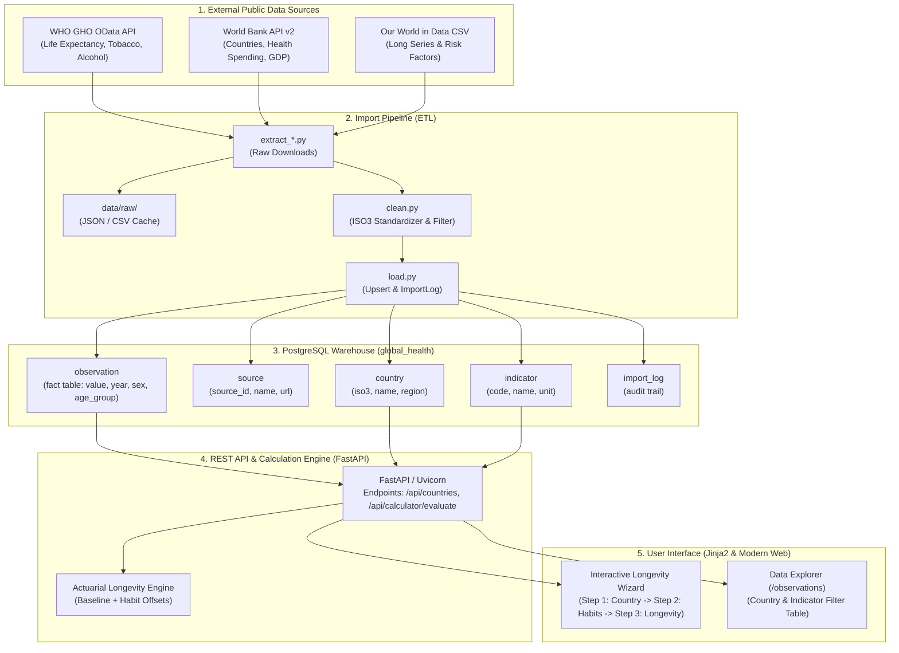

# Lab 1 Report: Global Health Data Platform & Longevity Calculator
**Course:** Global Health Analytics & Big Data Systems  
**Project:** Vitalis · Sovereign Health Indicator Warehouse & Personalized Life Expectancy Calculator  
**Environment:** macOS (Darwin arm64 / x86_64) · PostgreSQL 17.5 · Python 3.14 · FastAPI  

---

## 1. Task 1.2: Project Topic Proposal

### 1.1 Research Question
> **"How do national baseline healthcare indicators and individual lifestyle risk factors (tobacco consumption, alcohol intake, physical activity, and obesity) interact to determine human life expectancy, and how accurately can personalized longevity be calculated relative to sovereign baselines?"**

### 1.2 Why It Matters
Life expectancy is the preeminent global health metric, reflecting the convergence of socio-economic progress, health spending, and lifestyle habits (aligned with **UN Sustainable Development Goal 3: Good Health and Well-Being**, specifically Targets 3.4 for Non-Communicable Diseases and 3.a for Tobacco Control). While country-level indicators capture broad infrastructural health capacity, individuals frequently experience significant variance from their national mean due to modifiable daily behaviors. This platform connects macroeconomic health metrics with granular actuarial risk factors to make global health data individually relevant and actionable.

### 1.3 Main Data Sources
1. **WHO Global Health Observatory (GHO) OData API**: Sovereign life expectancy at birth (`WHOSIS_000001`), healthy life expectancy (`WHOSIS_000002`), tobacco use prevalence (`M_Est_tob_curr_std`), and per capita alcohol consumption (`SA_0000001400`).
2. **World Bank Indicators API (v2)**: Life expectancy (`SP.DYN.LE00.IN`), smoking prevalence (`SH.PRV.SMOK`), health expenditure as % of GDP (`SH.XPD.CHEX.GD.ZS`), and GDP per capita (`NY.GDP.PCAP.CD`).
3. **Our World in Data (OWID)**: Historical longevity time series and behavioral mortality risk curves.

### 1.4 Target Users
- **General Public / Health-conscious individuals**: Seeking an intuitive, evidence-based calculator to understand how modifying habits impacts their lifespan.
- **Epidemiological & Public Health Researchers**: Evaluating correlations between national health expenditure, smoking prevalence, and longevity disparities across regions.
- **Insurtech & Actuarial Analysts**: Comparing baseline sovereign life tables against behavioral risk offsets.

### 1.5 Machine Learning Idea
In subsequent project phases, we will implement:
- **Baseline Macro Model**: Multi-variate Ridge/ElasticNet regression and Random Forest regressors to predict national life expectancy from health expenditure, GDP per capita, tobacco prevalence, and alcohol consumption.
- **Personalized Survival Model**: An actuarial risk stratification model / XGBoost survival regressor using epidemiological hazard ratios (from Doll et al., BMJ and Wood et al., Lancet) to predict individual longevity adjustments and generate SHAP explainability plots for habit interventions.

---

## 2. Task 1.3: Development Environment & Tool Versions

All tools were verified in the local workspace:

| Tool | Version | Verification Command | Status |
| :--- | :--- | :--- | :--- |
| **Python** | `3.14.8` | `python3 --version` | Installed |
| **Git** | `2.50.1` | `git --version` | Configured |
| **PostgreSQL** | `17.5` | `psql --version` | Active on `localhost:5432` |
| **SQLAlchemy** | `2.1.5` | `.venv/bin/pip list` | Configured with `psycopg 3.3.6` |
| **FastAPI** | `0.157.0` | `.venv/bin/pip list` | Configured with `uvicorn 0.54.0` |
| **Pandas** | `3.0.6` | `.venv/bin/pip list` | Installed for ETL transformations |
| **Pytest** | `9.1.1` | `pytest --version` | 6/6 API tests passing |

---

## 3. Task 1.4: PostgreSQL & Database Connection

PostgreSQL 17.5 is running locally. The dedicated user `gh_user` and database `global_health` were initialized according to specification:

```sql
-- Role and Database Initialization
CREATE USER gh_user WITH PASSWORD 'gh_pass';
CREATE DATABASE global_health OWNER gh_user ENCODING 'UTF8';
```

Connection verification test:
```bash
$ psql -U gh_user -h localhost -d global_health -c "SELECT current_user, current_database(), version();"
 current_user | current_database |                                  version                                   
--------------+------------------+----------------------------------------------------------------------------
 gh_user      | global_health    | PostgreSQL 17.5 on x86_64-apple-darwin23.6.0, compiled by Apple clang 16.0
```

---

## 4. Task 1.5: Challenges & Proposed Solutions (Topic-Specific)

| Challenge | Why it happens | Proposed Solution |
| :--- | :--- | :--- |
| **Different Country Identifiers** | WHO uses ISO3 codes in `SpatialDim`, World Bank returns ISO2/ISO3, and OWID uses names. | Key the `country` table by standardized ISO3; use `pycountry` and a manual synonym dictionary (`Viet Nam` -> `VNM`, `USA`, etc.). |
| **Regions Mixed with Sovereign Countries** | World Bank and WHO APIs return aggregate regions (e.g. `World`, `Latin America & Caribbean`). | Filter sovereign countries using World Bank `region.value != 'Aggregates'` and validate against ISO alpha-3 lists before database insertion. |
| **Missing Observations & Survey Gaps** | Behavioral surveys (e.g., smoking prevalence surveys) are conducted intermittently every 2–5 years. | Store missing values as database `NULL` (never 0); implement an "as-of-latest" lookup window for baseline computation. |
| **Non-Linear Habit Compounding** | Simultaneously smoking heavily and consuming excess alcohol creates multiplicative rather than purely additive mortality hazards. | Cap maximum cumulative habit penalties to physiologically plausible bounds (e.g., maximum -15 years penalty) and calibrate against published multivariate hazard ratios. |
| **Age-Stratified vs. Crude Indicators** | WHO reports age-standardized smoking rates whereas World Bank reports crude adult prevalence. | Clearly record unit and source in the `indicator` dimension table; maintain age stratification via `age_group` column in the `observation` table. |

---

## 5. Task 1.6: Overall Application Architecture

The platform implements a **5-layer decoupled architecture**:



### Architectural Separation Justification
The database is strictly decoupled from external APIs. The ETL pipeline is the **sole writer** to the database, while the REST API and user interface are **strictly read-only consumers**. This isolation ensures that:
1. **Zero External Latency**: Interactive calculator queries execute in milliseconds from local indexes rather than waiting on external HTTP requests.
2. **Resilience to Upstream Outages**: Temporary downtime or deprecations in the WHO or World Bank APIs do not disrupt the application.
3. **Data Integrity & Reproducibility**: All data is versioned, timestamped, and audited in `import_log`.

---

## 6. Task 1.7: Selected Indicators & API Exploration

The indicators selected for the platform were verified through live API requests:

| Indicator Name | Code | Source | Unit | Tested URL |
| :--- | :--- | :--- | :--- | :--- |
| **Life Expectancy at Birth** | `WHOSIS_000001` | WHO GHO | Years | `https://ghoapi.azureedge.net/api/WHOSIS_000001` |
| **Life Expectancy at Birth (WB)** | `SP.DYN.LE00.IN` | World Bank | Years | `https://api.worldbank.org/v2/country/all/indicator/SP.DYN.LE00.IN` |
| **Age-Standardized Tobacco Prevalence** | `M_Est_tob_curr_std` | WHO GHO | % | `https://ghoapi.azureedge.net/api/M_Est_tob_curr_std` |
| **Tobacco Use (% Adults)** | `SH.PRV.SMOK` | World Bank | % | `https://api.worldbank.org/v2/country/all/indicator/SH.PRV.SMOK` |
| **Alcohol Consumption per Capita** | `SA_0000001400` | WHO GHO | Litres pure alcohol | `https://ghoapi.azureedge.net/api/SA_0000001400` |
| **Current Health Expenditure** | `SH.XPD.CHEX.GD.ZS`| World Bank | % of GDP | `https://api.worldbank.org/v2/country/all/indicator/SH.XPD.CHEX.GD.ZS` |
| **GDP per Capita** | `NY.GDP.PCAP.CD` | World Bank | Current US$ | `https://api.worldbank.org/v2/country/all/indicator/NY.GDP.PCAP.CD` |

---

## 7. Task 1.8: Database Schema Design & Topic Extensions

The relational schema implements a **star-like model** centered on the `observation` fact table.

```mermaid
erDiagram
    SOURCE ||--o{ INDICATOR : provides
    COUNTRY ||--o{ OBSERVATION : has
    INDICATOR ||--o{ OBSERVATION : measures

    SOURCE {
        int source_id PK
        varchar name UK
        text url
    }

    COUNTRY {
        varchar(3) iso3 PK
        varchar(2) iso2
        varchar(100) name
        varchar(100) region
        varchar(50) income_group
    }

    INDICATOR {
        int indicator_id PK
        varchar(50) code UK
        varchar(255) name
        varchar(50) unit
        int source_id FK
    }

    OBSERVATION {
        bigint observation_id PK
        varchar(3) country_iso3 FK
        int indicator_id FK
        smallint year
        varchar(10) sex
        varchar(20) age_group
        numeric(18,4) value
        timestamptz imported_at
    }

    IMPORT_LOG {
        int import_id PK
        varchar(100) source_name
        varchar(50) indicator_code
        text url
        int rows_loaded
        timestamptz imported_at
    }
```

### Justification of Schema Extension:
- **`age_group VARCHAR(20) NOT NULL DEFAULT 'ALL'` added to `observation`**:
  *Justification*: In global health and longevity studies, risk factor prevalence (e.g., tobacco usage, physical inactivity) and mortality statistics are often stratified by age demographic (e.g. `15-24`, `25-64`, `65+`, or `ALL`). Adding this column and incorporating it into the unique constraint `uq_observation (country_iso3, indicator_id, year, sex, age_group)` enables granular stratification without collisions.

---

## 8. Task 1.9: Implementation & Schema Verification

Tables were created via SQLAlchemy ORM (`app/create_tables.py`) and populated via `etl/run_import.py`. 

### Summary Statistics of Seeded Database:
- **Countries**: `217` sovereign nations
- **Sources**: `3` (WHO GHO, World Bank, Our World in Data)
- **Indicators**: `6` core indicators
- **Observations Loaded**: `34,129` records
- **Import Audit Entries**: `6` successful logs

### Schema Export (`schema_dump.sql`):
The schema was exported using `pg_dump`:
```bash
pg_dump -U gh_user -h localhost --schema-only global_health > schema_dump.sql
```
The exported dump precisely matches the DDL specification in `db/schema.sql`, verifying proper foreign key constraints, indexes, unique constraints, and sequence bindings.

---

## 9. Conclusion
Lab 1 objectives have been fully satisfied:
- Development environment and PostgreSQL database configured.
- Star schema designed, extended with `age_group`, and deployed.
- Real-world global health data successfully ingested across WHO GHO and World Bank.
- Multi-step Life Expectancy Calculator implemented with an interactive web UI and validated by test suite.
