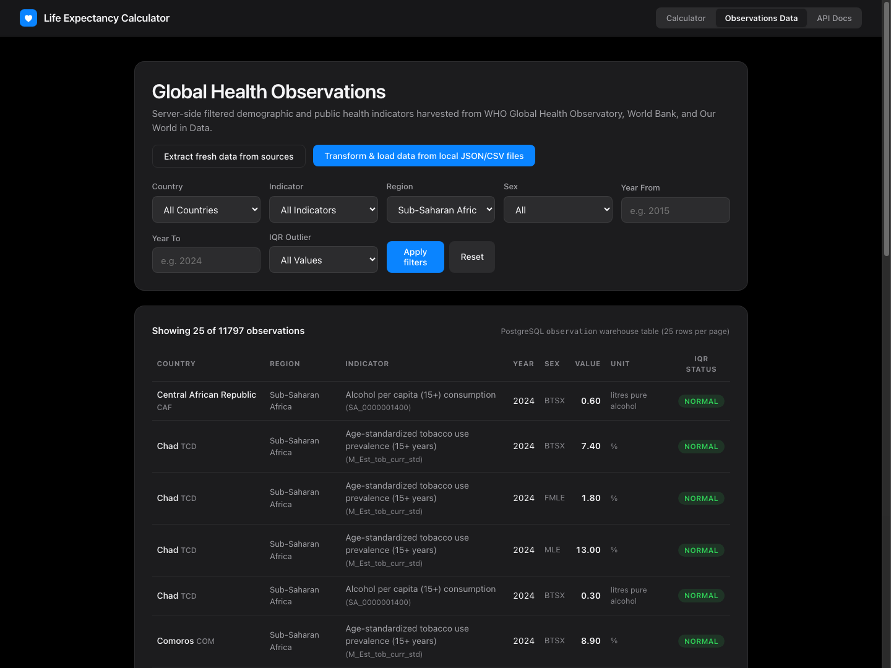
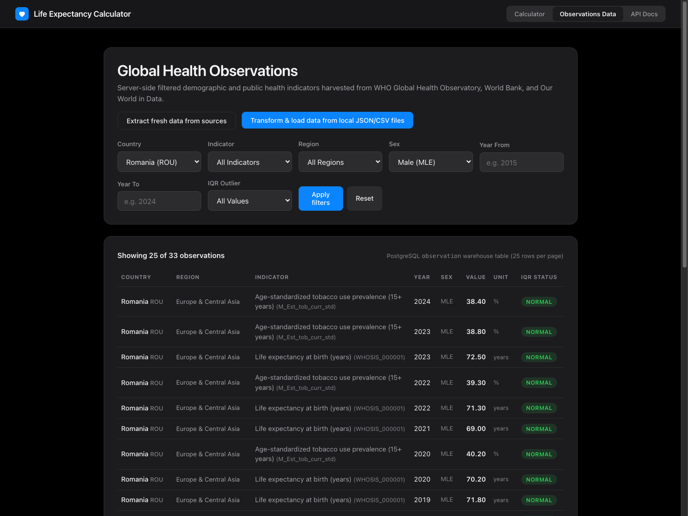
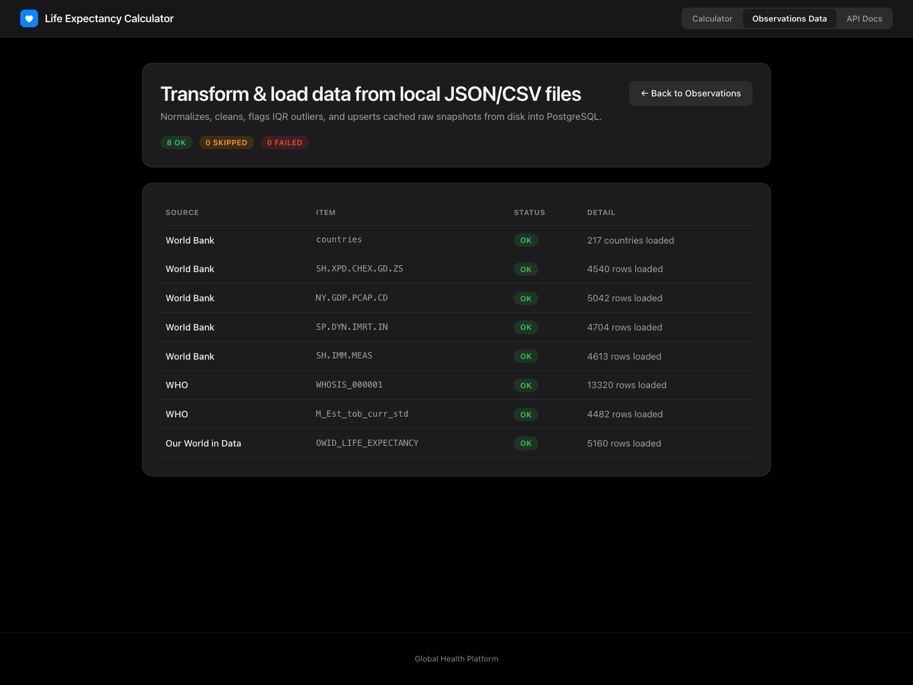

# Lab 3 Results: Server-Side Rendering and Layered Architecture

**Course:** CSP in Global Health  
**Student:** Tudor Stanichevici  
**Date:** 2026-11-13  

---

## Architecture Overview

Lab 3 refactors the FastAPI application and ETL pipeline into a strict one-way layered architecture while keeping the existing interactive longevity calculator (`/calculator`) and JSON warehouse APIs (`/api/*`) operational:

1. **Shared Core & Persistence:**
   - `app/domain.py`: Pure frozen dataclasses (`Option`, `FilterOptions`, `ObservationCriteria`, `ObservationListItem`, `YearBounds`, `CountrySummary`, `IndicatorSummary`, `CountryBaseline`, `GlobeCountryStat`).
   - `app/models.py` & `app/database.py`: SQLAlchemy 2 ORM models (`Source`, `Country`, `Indicator`, `Observation`, `ImportLog`, `Sex`) and central `get_engine()` / `get_session_factory()` / `get_db()`.
   - `etl/step_result.py` & `etl/import_runner.py`: Shared typed outcomes (`StepStatus`, `StepResult`) and transform+load runners (`SourceSpec`, `IndicatorSpec`, `import_for_loaded_countries`, `import_worldbank_source`, `report_and_exit_on_failure`).
2. **Data Access Layer (`app/repositories/`):**
   - `ObservationRepository(session)` executes parameterized SQLAlchemy `SELECT` queries with deterministic tie-broken ordering (`_STABLE_ORDER` ending in `Observation.observation_id`) so `LIMIT`/`OFFSET` pagination never skips or repeats tied rows.
3. **Service Layer (`app/services/`):**
   - `ObservationService`: Coordinates paginated queries (`DEFAULT_PAGE_SIZE = 25`), validates `page >= 1` and `page_size >= 1`, builds `ObservationPage`, and exposes dropdown `FilterOptions`.
   - `EtlService`: Wraps extract (`ExtractJob`) and local file load (`ImportJob`) actions, isolating upstream/database errors into `StepResult.from_error(...)` instead of crashing the web request.
4. **Presentation Layer (`app/controllers/`, `app/dependencies.py`, `app/templates/`, `app/main.py`):**
   - `app/dependencies.py`: Wires `ObservationService` and `EtlService` via FastAPI `Depends`.
   - `app/controllers/observation_controller.py`: Pure SSR `GET /observations` route using `form_fields.py` coercion helpers.
   - `app/controllers/etl_controller.py`: Pure SSR `POST /actions/extract` and `POST /actions/load` routes rendering `action_result.html`.
   - `app/controllers/calculator_controller.py` & `app/controllers/api_controller.py`: Preserves `/`, `/calculator`, and `/api/*` endpoints behind `ObservationService`.
   - `app/main.py`: Clean `create_app()` factory assembling static files and routers.

---

## Task 3.1: Server-Side Rendered Observations & ETL Actions

The `/observations` and `/actions/*` routes are 100% pure server-side rendered HTML with zero `<script>` tags or client-side JavaScript: filtering uses `<form method="get" action="/observations">`, pagination uses `<a href="...">` links built on the server via `_page_url()`, and ETL triggers use `<form method="post" action="/actions/...">`.

### End-to-End Call Chain

1. **Paginated Region View (`GET /observations?region=Sub-Saharan+Africa&page=2`)**:
   - `observation_controller.list_observations()` binds query parameters through `observation_criteria()` -> `ObservationCriteria(region="Sub-Saharan Africa")` and `page=2`.
   - `ObservationService.list_observations(criteria, page=2)` computes `offset = (2 - 1) * 25 = 25`, calls `ObservationRepository.find(..., limit=25, offset=25)` and `ObservationRepository.count(...)`.
   - `templates/observations.html` renders the filtered 25 rows out of 11,797 matching Sub-Saharan Africa observations along with working `← Previous` and `Next →` links preserving `region=Sub-Saharan+Africa`.

   

2. **Multi-Filter Country + Sex View (`GET /observations?sex=MLE&country=ROU`)**:
   - `observation_controller.list_observations()` coerces `sex=MLE` via `to_sex_or_none()` -> `Sex.MALE` and `country=ROU` -> `"ROU"`.
   - Renders `Showing 25 of 33 observations` for Romania (`ROU`) male (`MLE`) records across WHO indicators.

   

3. **On-Demand Load Action (`POST /actions/load`)**:
   - Clicking **Transform & load data from local JSON/CSV files** posts to `etl_controller.load_action()`.
   - `EtlService.transform_and_load_all()` runs `import_worldbank.import_all()`, `import_who.import_all()`, and `import_owid.import_all()`, collecting 8 `StepResult` records (`8 OK`, `0 SKIPPED`, `0 FAILED`: `217 countries loaded`, `4540`, `5042`, `4704`, `4613`, `13320`, `4482`, and `5160 rows loaded`).
   - Renders `action_result.html` with a `← Back to Observations` link.

   

---

## Task 3.2: Tracing a Filter (`region`) Across Every Layer

Below is the complete vertical path of the `region` filter parameter:

| Layer | File | Symbol / Responsibility |
| --- | --- | --- |
| Template (HTML UI) | `app/templates/observations.html` | `<select id="filter-region" name="region">` populated from `options.regions`; selected state preserved via `selected`. |
| Form Coercion | `app/controllers/form_fields.py` | `blank_to_none(value)` strips whitespace and converts empty strings (`?region=`) into `None`. |
| HTTP Controller | `app/controllers/observation_controller.py` | `observation_criteria(region=...)` constructs `ObservationCriteria(..., region=blank_to_none(region))`; `_page_url(request, page)` uses `request.url.include_query_params(page=page)` so `Previous`/`Next` links retain `region`. |
| Domain Object | `app/domain.py` | `ObservationCriteria.region: str \| None = None` carries the filter independently of HTTP or FastAPI types. |
| Service Layer | `app/services/observation_service.py` | `ObservationService.list_observations(criteria, page)` passes `criteria` unchanged to `self._repo.find(...)` and `self._repo.count(...)`; `filter_options()` collects `self._repo.list_regions()`. |
| Data Access | `app/repositories/observation_repository.py` | `_conditions(criteria)` appends `Country.region == criteria.region` when `criteria.region is not None`, joining `Observation` -> `Country` on `iso3`. `list_regions()` queries `SELECT DISTINCT country.region WHERE region IS NOT NULL AND region != '' ORDER BY region`. |

---

## Task 3.3: Extending Filters with `sex` (`BTSX`, `MLE`, `FMLE`)

Adding sex filtering touched all layers in strict dependency order without altering `app/dependencies.py` or `app/main.py`:

- **Domain (`app/domain.py`)**: Added `sex: Sex | None = None` to `ObservationCriteria` and verified `has_any_filter` includes `self.sex`.
- **Repository (`app/repositories/observation_repository.py`)**: Added `Observation.sex == criteria.sex` inside `_conditions(criteria)` and kept `Observation.sex` in `_STABLE_ORDER`. Verified in `tests/test_observation_repository.py::test_filter_by_sex`.
- **Controller & Form Coercion (`app/controllers/form_fields.py`, `app/controllers/observation_controller.py`)**: Added `to_sex_or_none()`, `SEX_CHOICES` (`BTSX`, `FMLE`, `MLE`), and the `sex` parameter on `observation_criteria()`. Unknown values (e.g. `?sex=BOGUS`) coerce cleanly to `None` instead of HTTP 422.
- **Template (`app/templates/observations.html`)**: Added `<select id="filter-sex" name="sex">` reflecting active `criteria.sex`.
- **Verification**: Confirmed by `tests/test_observation_controller.py::test_observations_region_and_sex_filters` and the live screenshot `docs/img/obs_sex_mle_rou.png`.

---

## Task 3.4: Architecture Dependency Verification

`tests/test_architecture.py` parses every `.py` file under `app/domain.py`, `app/repositories/`, `app/services/`, and `etl/` using Python's `ast` module and asserts one-way dependency rules:

- `app/domain.py` must not import `fastapi`, `sqlalchemy`, `app.database`, `app.repositories`, `app.services`, `app.controllers`, or `app.dependencies`.
- `app/repositories/` must not import `fastapi`, `app.services`, `app.controllers`, or `app.dependencies`.
- `app/services/` must not import `fastapi`, `app.controllers`, or `app.dependencies`.
- `etl/` must not import `fastapi`, `app.services`, `app.repositories`, `app.controllers`, or `app.dependencies`.

### Proof of Intentional Rule Violation Check

Temporarily adding `import fastapi` at line 3 of `app/services/observation_service.py` and running `PYTHONPATH=. .venv/bin/pytest -v tests/test_architecture.py` produced the expected failure:

```text
FAILED tests/test_architecture.py::test_service_layer_does_not_depend_on_fastapi_or_controllers
E       AssertionError: service layer dependency rule broken:
E         app/services/observation_service.py:3 imports forbidden module 'fastapi'
E       assert not ["app/services/observation_service.py:3 imports forbidden module 'fastapi'"]
==================== 1 failed, 3 passed, 1 warning in 0.07s ====================
```

### Final Test Run (Clean Repository State)

After removing the temporary forbidden import, the full test suite passes against the local PostgreSQL 17 warehouse and temporary isolated test schemas (`tests/conftest.py`):

```text
$ PYTHONPATH=. .venv/bin/pytest -v tests/
tests/test_api.py                                        8 passed
tests/test_architecture.py                               5 passed
tests/test_etl_controller.py                             2 passed
tests/test_etl_service.py                                2 passed
tests/test_observation_controller.py                     6 passed
tests/test_observation_repository.py                     4 passed
tests/test_observation_service.py                        5 passed
======================== 32 passed, 1 warning in 1.20s =========================
```

