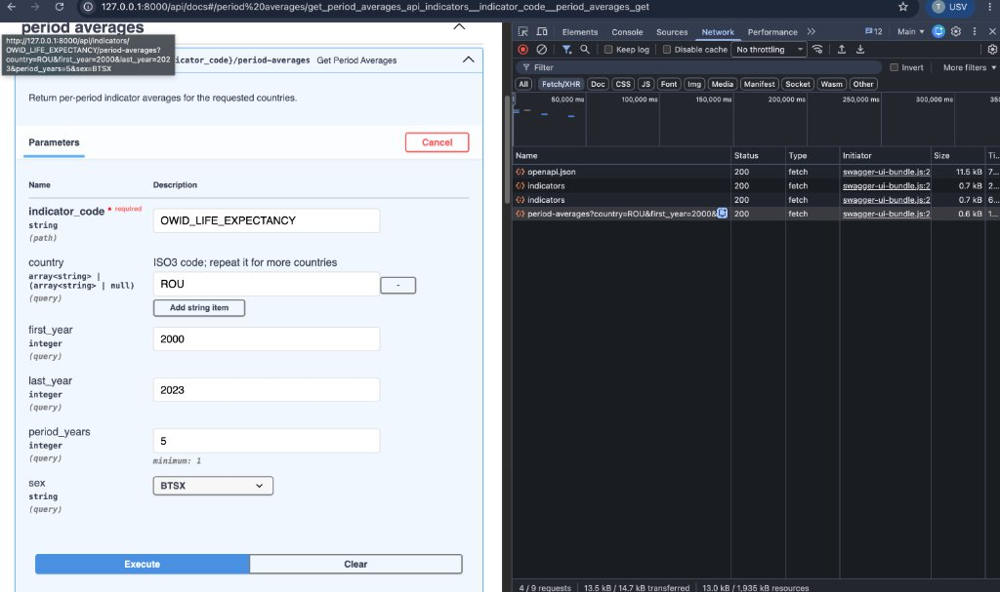
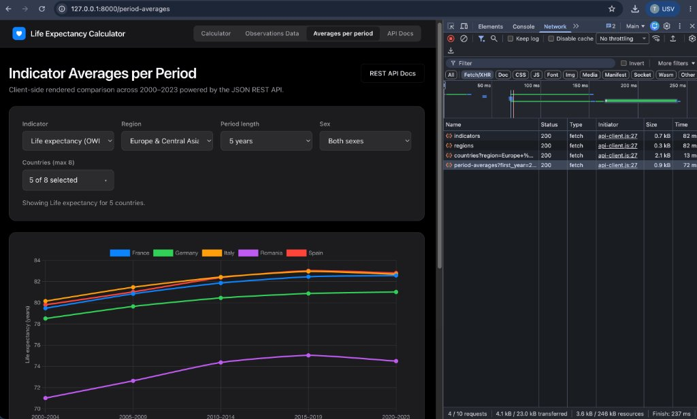
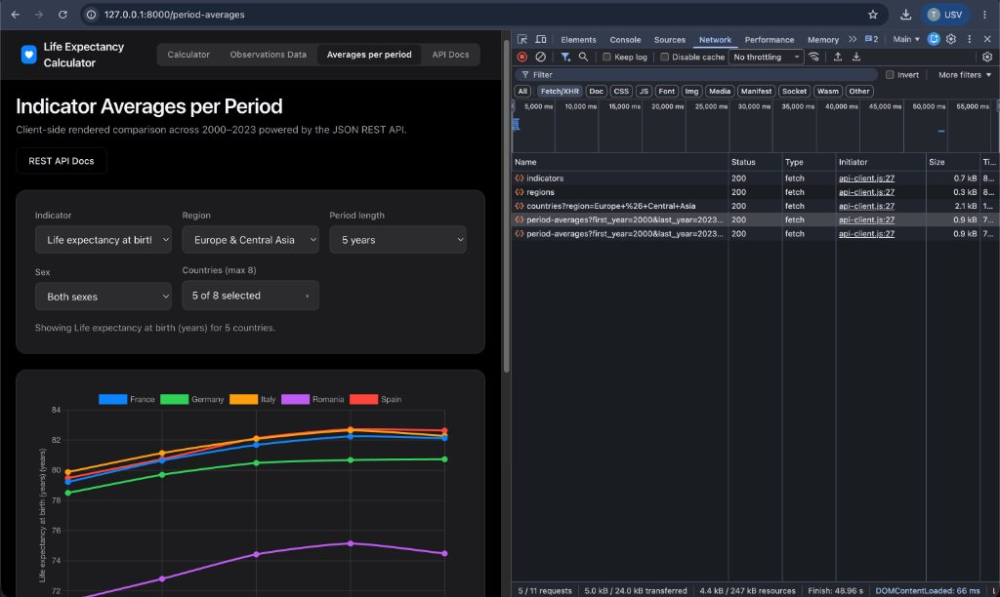

# Lab 4 Results: Client-Side Rendering and REST API

**Course:** CSP in Global Health  
**Student:** Tudor Stanichevici  
**Date:** 2026-11-18  

---

## Task 4.1: REST API Requests, Responses, and Status Codes

All endpoints were verified against the running FastAPI application (`uvicorn app.main:app`) backed by the local PostgreSQL 17 warehouse.

### 1. Lookup Endpoints (`app/controllers/api/reference_data_api.py`)

- **`GET /api/regions` → `200 OK`**
  ```json
  [
    "East Asia & Pacific",
    "Europe & Central Asia",
    "Latin America & Caribbean",
    "Middle East, North Africa, Afghanistan & Pakistan",
    "North America",
    "South Asia",
    "Sub-Saharan Africa"
  ]
  ```

- **`GET /api/countries?region=Europe%20%26%20Central%20Asia` → `200 OK`**
  Returns `CountryResponse` DTOs (`{"iso3", "name"}`) filtered by region, omitting internal fields like `iso2` or `income_group`:
  ```json
  [
    {"iso3": "ALB", "name": "Albania"},
    {"iso3": "AND", "name": "Andorra"},
    {"iso3": "ARM", "name": "Armenia"}
  ]
  ```

- **`GET /api/indicators` → `200 OK`**
  Returns `IndicatorResponse` DTOs (`{"code", "name"}`), hiding database `indicator_id` and `source_id`:
  ```json
  [
    {"code": "M_Est_tob_curr_std", "name": "Age-standardized tobacco use prevalence (15+ years)"},
    {"code": "OWID_LIFE_EXPECTANCY", "name": "Life expectancy"},
    {"code": "WHOSIS_000001", "name": "Life expectancy at birth (years)"}
  ]
  ```

- **`GET /api/indicators/OWID_LIFE_EXPECTANCY` → `200 OK`**
  Returns `IndicatorDetailResponse` (`{"code", "name", "unit"}`):
  ```json
  {
    "code": "OWID_LIFE_EXPECTANCY",
    "name": "Life expectancy",
    "unit": "years"
  }
  ```

### 2. Per-Period Averages (`app/controllers/api/period_average_api.py`)

- **`GET /api/indicators/OWID_LIFE_EXPECTANCY/period-averages?country=ROU&country=FRA` → `200 OK`**
  Uses defaults (`first_year=2000`, `last_year=2023`, `period_years=5`, `sex=BTSX`) and returns JSON numbers (`float | None`) rounded half-up to 2 decimals:
  ```json
  {
    "indicator": {
      "code": "OWID_LIFE_EXPECTANCY",
      "name": "Life expectancy",
      "unit": "years"
    },
    "periods": [
      {"start": 2000, "end": 2004, "label": "2000–2004"},
      {"start": 2005, "end": 2009, "label": "2005–2009"},
      {"start": 2010, "end": 2014, "label": "2010–2014"},
      {"start": 2015, "end": 2019, "label": "2015–2019"},
      {"start": 2020, "end": 2023, "label": "2020–2023"}
    ],
    "series": [
      {"country_iso3": "FRA", "country_name": "France", "averages": [79.49, 80.85, 81.87, 82.46, 82.58]},
      {"country_iso3": "ROU", "country_name": "Romania", "averages": [71.01, 72.64, 74.37, 75.04, 74.5]}
    ]
  }
  ```

- **Sex-specific query (`GET /api/indicators/WHOSIS_000001/period-averages?country=ROU&sex=MLE&first_year=2015&last_year=2023&period_years=3`) → `200 OK`**
  ```json
  {
    "indicator": {"code": "WHOSIS_000001", "name": "Life expectancy at birth (years)", "unit": "years"},
    "periods": [
      {"start": 2015, "end": 2017, "label": "2015–2017"},
      {"start": 2018, "end": 2020, "label": "2018–2020"},
      {"start": 2021, "end": 2023, "label": "2021–2023"}
    ],
    "series": [
      {"country_iso3": "ROU", "country_name": "Romania", "averages": [71.43, 71.13, 70.93]}
    ]
  }
  ```

### 3. Error Status Codes (`404` and `422`)

- **Unknown indicator (`GET /api/indicators/UNKNOWN_CODE/period-averages?country=ROU`) → `404 Not Found`**
  `UnknownIndicatorError` is mapped by the controller to HTTP `404`:
  ```json
  {"detail": "unknown indicator 'UNKNOWN_CODE'"}
  ```
- **Invalid year range (`GET /api/indicators/OWID_LIFE_EXPECTANCY/period-averages?country=ROU&first_year=2020&last_year=2010`) → `422 Unprocessable Content`**
  `InvalidQueryError` is mapped by the controller to HTTP `422`:
  ```json
  {"detail": "first_year 2020 is after last_year 2010"}
  ```
- **Invalid query parameter (`GET /api/indicators/OWID_LIFE_EXPECTANCY/period-averages?country=ROU&period_years=0`) → `422 Unprocessable Content`**
  Rejected by FastAPI `Query(ge=1)` validation before the service is called.

### 4. Interactive OpenAPI Documentation (`/api/docs`)



---

## Task 4.2: Client-Side Rendering vs. Server-Side Rendering

| Aspect | `/observations` (Lab 3 – SSR) | `/period-averages` (Lab 4 – CSR) |
| --- | --- | --- |
| **Where HTML is built** | On the server with Jinja2 (`observations.html`) | In the browser with JavaScript (`period-averages-view.js`) |
| **Initial load** | Server queries PostgreSQL and sends complete HTML | Server sends empty HTML shell + 4 ES modules (`api-client.js`, `period-averages-model.js`, `period-averages-view.js`, `period-averages-page.js`) |
| **Changing a filter** | Full browser navigation (`GET /observations?...`) and full page reload | `fetch()` calls to `/api/countries` and `/api/indicators/{code}/period-averages`; only the chart and table update |
| **Concurrency** | Browser cancels previous page navigation automatically | `AbortController` in `period-averages-page.js` cancels outdated in-flight `fetch()` requests |
| **API reuse** | HTML-only endpoint | Same JSON REST API (`/api/docs`) usable by mobile apps, notebooks, and scripts |

### Browser Verification & Network Inspection

1. **Initial page load (`GET /period-averages`):**
   The shell loads once and JavaScript fetches `/api/indicators`, `/api/regions`, `/api/countries?region=Europe+%26+Central+Asia`, and `/api/indicators/OWID_LIFE_EXPECTANCY/period-averages` (`200 OK`, initiated by `api-client.js`):

   

2. **Changing a filter (no page reload):**
   Switching the indicator to `Life expectancy at birth (years) (WHOSIS_000001)` triggers a single `fetch()` call to `/api/indicators/WHOSIS_000001/period-averages` and updates only the chart and table:

   

---

## Task 4.4: Layered Design & Extensions (`sex` Choice & Single-Indicator Endpoint)

- **Strict One-Way Layers (Backend & Frontend):**
  - Backend: `controllers/api/` → `services/` → `repositories/` → `domain.py` / `models.py` (enforced by `tests/test_architecture.py`).
  - Frontend: `period-averages-page.js` (controller) → `api-client.js` (only module calling `fetch()`), `period-averages-model.js` (pure transformations + `ColorSlots`, zero DOM/`fetch`), and `period-averages-view.js` (DOM + Chart.js, using `textContent` to prevent XSS).
- **`sex` Choice:** `PeriodAverageQuery.sex` defaults to `Sex.BOTH` (`BTSX`) and accepts `BTSX`, `MLE`, or `FMLE` via `?sex=...` on `/api/indicators/{code}/period-averages` and the `#sex` `<select>` on `/period-averages`.
- **Single-Indicator Endpoint:** `GET /api/indicators/{indicator_code}` reuses `PeriodAverageService.get_indicator()` and `IndicatorDetailResponse`, returning `404` when the code does not exist.

### Automated Test Suite

```text
$ PYTHONPATH=. .venv/bin/pytest -v tests/
48 passed, 1 warning in 2.65s
```
